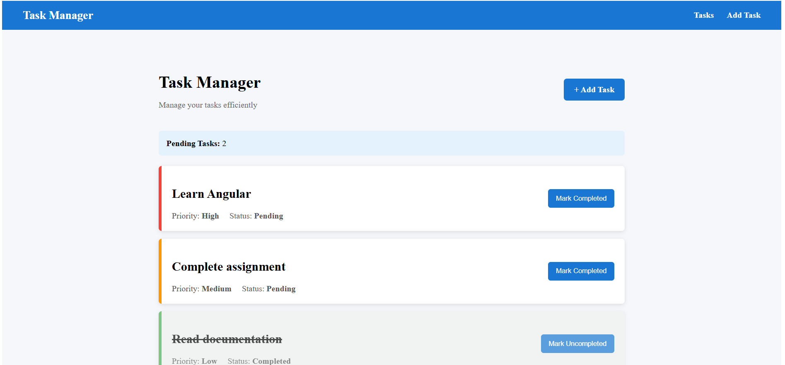
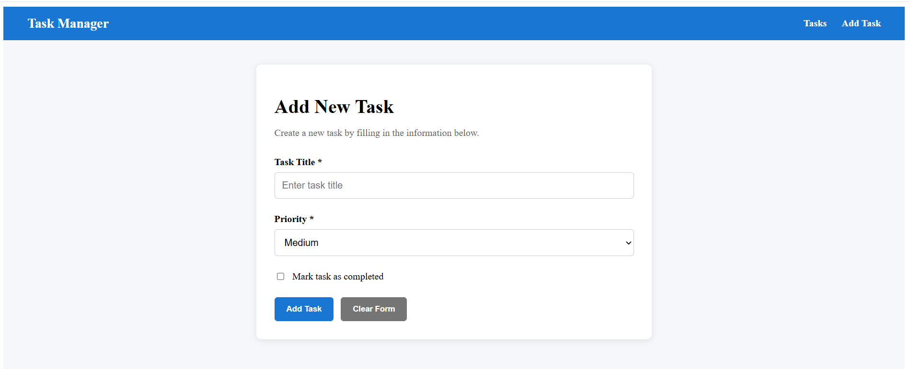

# Task Manager

A small Angular application for organizing tasks by priority and completion status. It demonstrates standalone components, reactive forms, Angular Router, a shared service, and dependency injection.

## Features

- View tasks with their title, priority, and completion status.
- See distinct visual treatments for Low, Medium, and High priority tasks.
- Mark tasks completed or pending; completed tasks are styled differently.
- See the current pending-task count and an empty-state message when there are no tasks.
- Add tasks with a title, priority, and optional completed status.
- Validate task titles and clear or reset the form.
- Navigate between the task list and add-task form using Angular Router.

Tasks are currently stored in memory by `TaskService`; they reset when the application is reloaded.

## Requirements

- Node.js and npm

## Run Locally

Install the dependencies and start the Angular development server:

```bash
npm install
npm start
```

Open [http://localhost:4200](http://localhost:4200). The root route redirects to `/tasks`.

Useful commands:

```bash
npm run build  # Build the application
npm test       # Run unit tests
```

## Application Structure

| Area | Location | Responsibility |
| --- | --- | --- |
| Root application | `src/app/app.ts` | Hosts the navigation and routed views. |
| Task list | `src/app/components/task-list/` | Displays tasks, completion controls, empty state, and pending count. |
| Add task | `src/app/components/add-task/` | Provides the reactive form for creating tasks. |
| Task service | `src/app/services/task.ts` | Stores tasks and exposes retrieval, add, and completion-update operations. |
| Task model | `src/app/models/task.model.ts` | Defines the task shape and allowed priority values. |

## Routes

| Path | View | Behavior |
| --- | --- | --- |
| `/tasks` | Task list | Displays the current tasks. |
| `/add-task` | Add task | Opens the task form; successful submission returns to `/tasks`. |
| `/` | Redirect | Redirects to `/tasks`. |
| Unknown path | Redirect | Redirects to `/tasks`. |

## Angular Concepts

- **Components:** The task list and add-task form are separate standalone components.
- **Reactive Forms:** The add-task form uses `FormBuilder`, validators, touched-state validation messages, and form reset behavior.
- **Routing:** `RouterLink`, `RouterOutlet`, and configured routes switch views without manually changing the page URL.
- **Services:** `TaskService` owns the in-memory task data and task operations.
- **Dependency Injection:** `TaskService` is provided at the root and injected into the components that use it.
- **Templates and binding:** Angular control flow, interpolation, property/class binding, and event binding render and update task state.

## Screenshots

Add screenshots to a `screenshots/` directory at the repository root. Suggested filenames:

- `screenshots/task-list.png` - task list with priority and completion status visible.
- `screenshots/add-task-form.png` - add-task form, preferably showing its validation messages.

After adding the image files, uncomment the matching image line(s) below so they appear in this section:




